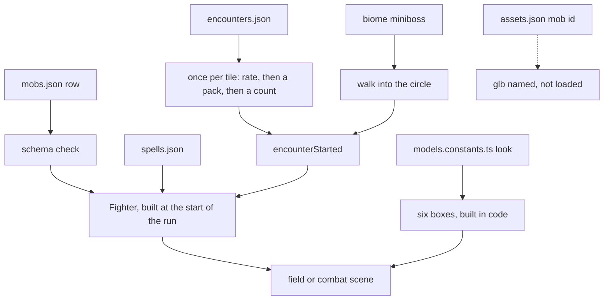

# Mobs

How prototype one gets a mob into a fight and onto the screen. Nothing procedural invents a body or a stat block. Two records share an id, and only one of them is drawn.

The fight comes from `prototypes/one/bundle/mobs.json`. The figure comes from `src/view/art/models.constants.ts`. The meadow decides which ids show up, in `prototypes/one/bundle/encounters.json` and on the biome.



## 1. The row

Each mob is one object in `mobs.json`. The id is `mob.` plus a name, such as `mob.slime`. `src/content/schema.ts` checks the row before a run can start.

A row carries the combat numbers: hp, str, def, mag, haste, and xp. It may also carry mp, a weakness, a resistance, a potion-drop chance, and `miniboss: true`. It always carries at least one weighted action. The action is an attack, a spell id, or a grind with a damage multiplier.

The ember imp and the frost moth also name an `element` on the row. The fight does not read that field. Weakness and resistance are copied onto the fighter. A spell's element, power, and cost come from `spells.json` when the action is turned into a fighter action. An unknown spell id fails the load.

Prototype one has four rows:

| Id | Shape on screen | What it does |
| --- | --- | --- |
| `mob.slime` | blob | Attack only. Shows up in grass and on the path. |
| `mob.ember_imp` | person | Attack, or Ember. Weak to ice. Grass and forest. |
| `mob.frost_moth` | moth | Attack, or Frost. Weak to fire. Grass and forest. |
| `mob.rust_sentinel` | person | Attack, or grind. The biome's miniboss. Not in the encounter tables. |

## 2. From a row to a fighter

At the start of a run, `runMobsFromBundle` in `src/content/rules.ts` walks the list once. `enemyFighterFromMob` copies each row into the fighter the sim swings at: the same id, hp as both current and max, mp defaulting to 0, and the actions with their weights. A spell action is filled in from the spell list. The potion-drop chance stays beside the fighter, on the run's mob record, and is rolled after a win.

The sim never sees a color, a size, or a file path.

## 3. Who shows up on the meadow

`encounters.json` does not create mobs. It names packs of ids that already exist.

Grass, forest, and path each have a rate and a weighted list of packs. Water and mountain do not roll. The rates in prototype one are 0.1 on grass, 0.15 in forest, and 0.04 on the path. A pack is one or more groups. A group is a mob id plus a min and a max count.

`EncounterController` counts distance on the terrain under the hero. Once per full tile, after a gap from the last fight, it rolls that terrain's rate. A hit picks a pack by weight, then a count from min to max. A group whose min and max match spends no roll. The step that hits returns `encounterStarted` with those groups, and the walk stops.

The rust sentinel is named on the biome, not in those tables. Walking into its circle starts a fight of one, with no encounter roll.

A pack the player asked for with `?combat=` skips the meadow. The same fighter table plays that list, one mob at a time.

## 4. The figure

`models.constants.ts` is a second table, keyed by the same id. A look is a body color, a face color, a width, a height, an optional hover, and a shape. `buildMobModel` in `src/view/art/models.ts` turns the look into six boxes. The group's origin is at the feet, and local +z is the way it faces. An id with no look becomes the gray person in `unknownMobLook`.

The three shapes:

- **person.** Two legs, a torso, a light head, and two arms. The hero, the ember imp, and the rust sentinel.
- **blob.** Two feet, a body, a cap, and two eyes on the front. The slime.
- **moth.** A body, a head, two wings, and two antennae. The frost moth. `hover: 0.5` lifts it, and the combat scene uses that flag for a taller idle bob.

The field draws the miniboss with `buildMobModel`. Combat draws every mob in the pack the same way, and the hero from `heroLook`, which is the same kind of table and not a mob row.

## 5. The model files that are not on screen

`prototypes/one/bundle/assets.json` already reserves a logical id per mob, such as `mob.slime.model`, and points it at `assets/generated/mob.slime.model.glb`. Those glbs are not in the repo. The generated files that do exist are the terrain PNGs.

The field scene and the combat scene never ask the loader for a model id. They call `buildMobModel`. A missing file, when something does ask for it, is skipped rather than drawn. The colored boxes are the figure until a loader path asks for the id.

## A folder for the look

The combat row stays in the bundle. The sim and the content check already load `prototypes/one/bundle/`. A later home for the figure, next to the assets and not built yet, is one folder per id:

```text
assets/mobs/mob.slime/look.json
```

`look.json` would be the look that `models.constants.ts` holds now. Encounters stay in the bundle. They choose packs, not colors. The manifest can keep pointing `mob.slime.model` at a glb. The rule that a hand-built file wins over a generated one stays as it is. That swap is not part of this folder.
