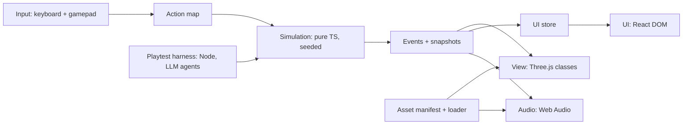

# Tech stack and ways of working

Mechanics live in `docs/game_design.md`; this doc covers how we build them. Decisions below are signed off unless listed under open questions.

## Goals

- Runs in the browser, deployed as static files over HTTP.
- Fast boot with a clean loader, and lazy-loaded assets per biome.
- Three.js as the engine foundation, TypeScript everywhere, native browser APIs first, npm packages only where they beat the native API.
- Keyboard and controller input, rebindable in options.
- Every asset (model, texture, sound, music) can start procedural or LLM-generated and be swapped for a hand-built version without code changes.
- A functional test harness that lets LLM playtesters play the game headlessly, so balance and bugs can be explored at scale.
- Treat this as practice for a real game pipeline: build, content, assets, tests, CI, deploy.

## Stack at a glance

| Area | Decision |
| --- | --- |
| Framework | Purpose-built thin framework on Three.js. No game framework. |
| Game rules | Pure, seeded TypeScript simulation. No DOM, no Three.js. |
| 3D view | Plain Three.js classes with `WebGPURenderer`. We own the render loop. |
| UI | React DOM overlay for menus and HUD. |
| Content | Data files validated by zod schemas. |
| UI state | zustand store mirroring sim snapshots. |
| Build | Vite, TypeScript strict. |
| Lint and format | Biome only. |
| Tests | Vitest (sim), headless sim CLI, LLM playtesters, Playwright (browser). |
| Hosting | Josh's private server, served under `joshbosworth.com/roguelike_rpg`. |
| Pixel look | Pixel textures on low-poly models. No low-resolution render target. |
| Asset tools | GIMP, Blender, DAW to be decided. |

## Why purpose-built, not a game framework

Three.js game frameworks we looked at:

| Option | What it is | Why not |
| --- | --- | --- |
| [@jolly-pixel/engine](https://www.npmjs.com/package/@jolly-pixel/engine) | Minimal TypeScript ECS on Three.js: actors, behaviors, signals, input, lazy assets, audio. | Closest to what we'd build, but young. Worth reading for patterns. |
| [gama3d](https://www.npmjs.com/package/gama3d) | Small library: loop, entities, input, cameras, tweening, steering agents. | Also young. Its steering agents could inspire field mob wandering. |
| [Needle Engine](https://engine.needle.tools/docs/three/) | Full component engine on a Three.js fork, Unity/Blender export. | Paid seats for commercial use, forks Three.js, Unity-shaped workflow. |
| [enable3d](https://github.com/enable3d/enable3d) | Three.js plus ammo.js physics. | LGPL, older Three.js, physics-focused. |

The reasons:

- **The game is a turn-based menu RPG.** Most framework weight (physics, character controllers, networking) solves problems we don't have.
- **Frameworks couple game logic to the render loop.** The playtester harness needs the rules to run in Node, thousands of times, with no canvas.
- **The asset swap pipeline is custom either way.**
- **Learning the pipeline is a goal.** The plumbing we own (loop, input map, loader, scene stack) is a few hundred lines each.

## Why React for UI, plain Three.js for the game

The simulation, content, assets, input, audio, and harness are plain TypeScript regardless. React vs. classes only affected the view and the UI, so we took the strength of each:

- **React for menus.** The game is menu-heavy (command window, 16+ inventory slots, character sheet, shop, stash, loadout, options, rebinding), and Josh knows React deeply.
- **Plain Three.js classes for the field and combat stage.** Full control of the frame loop, explicit lifecycles (`load`, `enter`, `update`, `exit`, `dispose`), and combat playback that reads top to bottom: `await hero.lunge(target); await target.flash(); popDamage(12);`.
- **React Three Fiber is not needed** for this split, since React never renders the 3D scene. We can add it later if we want 3D UI elements (floating nameplates, a 3D item preview in the inventory).

Three rules keep the split honest:

1. **The sim decides every outcome.** React and Three.js only draw and animate.
2. **Nothing that changes every frame goes through React state.** React re-renders on sim events and menu changes, not per frame.
3. **Combat playback runs through one imperative sequencer** in the view.

## Architecture



### The simulation (`src/sim`)

- Pure TypeScript. No DOM, no Three.js, no React, no `Math.random`.
- **Seeded RNG** for everything: procgen, encounter rolls, loot, damage. Same seed plus same actions gives the same run.
- **Command in, events out.** The sim exposes a small interface:
  - `observe()` returns a structured snapshot of what the player can see.
  - `legalActions()` lists what the player can do right now.
  - `act(action)` applies one action and returns the events it caused (damage dealt, item dropped, turn order changed).
- The view and UI animate from those events. The playtester harness reads the same snapshot and events as JSON.
- Combat is a **haste-ordered turn queue** state machine. The field (walking, encounter rolls, miniboss packs) is a separate state. A small scene stack switches between town, field, combat, inn.
- **No ECS to start.** A turn-based game with dozens of actors doesn't need one. If field entities grow, add [miniplex](https://github.com/hmans/miniplex).

How purity is enforced (Biome alone can't express every rule):

- `src/sim` gets its own `tsconfig` with no DOM library, so `window` and `document` fail type-checking.
- Biome's restricted-imports rule, scoped to `src/sim/**`, blocks `three`, `react`, and anything under `src/view` or `src/ui`.
- A small check script fails CI if `Math.random` appears in `src/sim`.

### Content as data: bundles (`src/content`)

- Mobs, items, boons, races, biomes, loot tables, and tuning numbers are **data files** (JSON), not code, packaged into **bundles**. A bundle is rules plus content plus an asset manifest; the engine loads one to make something playable. The full definition is in `docs/prototypes/one.plan.md`.
- `src/content` holds the **[zod](https://zod.dev/) schemas** and the bundle loader. LLM-generated content must pass validation before it can load. Schemas also give us the TypeScript types for content.
- `npm run content:check` validates every bundle; CI runs it.

### Prototypes (`prototypes/`)

- Engine code in `src/` is shared and grows across prototypes.
- Each prototype is a thin folder `prototypes/<name>/`: an entry page, a config that turns engine features on, and its bundle. Its plan lives at `docs/prototypes/<name>.plan.md`.
- Prototypes never import from each other. Finished prototypes get a git tag so they can always be rebuilt.

### The view (`src/view`)

- Plain Three.js classes for the 3/4 field and the combat stage. One render loop, owned by us.
- **`WebGPURenderer`**, imported from `three/webgpu`. It falls back to WebGL2 automatically on browsers without WebGPU.
- Custom shaders are written in **TSL** (Three.js Shading Language, node materials), not raw GLSL. TSL compiles to both backends.
- Reads sim snapshots, plays animations from sim events. Never decides game outcomes.
- **Pixel look is textures only**: `NearestFilter` pixel textures on low-poly models, rendered at full resolution.
- **Global illumination is a risk.** Real-time GI is expensive in the browser. Plan to approximate it: light probes, a sky light driven by day/night, ambient occlusion, baked lighting for procgen chunks. Prototype this early.

### UI (`src/ui`)

- **React DOM overlay** on top of the canvas: command window, inventory, character sheet, shop, stash, options. HTML/CSS with a pixel font.
- A **[zustand](https://zustand.docs.pmnd.rs/)** store mirrors the latest sim snapshot. Components read it; they never change game state directly. Menu choices become sim actions.
- Every menu is navigable with actions only (up, down, confirm, cancel), so keyboard, controller, and the test harness drive it the same way.

### Input (`src/input`)

- Native `KeyboardEvent` and the **Gamepad API**. No library needed.
- Devices map to **actions** (`confirm`, `cancel`, `menu_up`, `move_x`, …). Game code and UI only see actions.
- Bindings live in a config object, saved to `localStorage`, editable in the options screen.

### Audio (`src/audio`)

- Native **Web Audio API**: a mixer with buses for music, SFX, UI.
- Music as **stems per biome** that layer and crossfade (calm field, danger nearby, combat, boss). Suits authored electronic music and leaves room for procedural layers.
- [Tone.js](https://tonejs.github.io/) is an option later for procedural or generative music; not needed to start.

## Assets: generated first, authored when ready

### Logical IDs and a manifest

- Code never references a file path. It asks for a **logical ID**: `mob.slime.model`, `biome.meadow.music.combat`, `ui.font.main`.
- A **manifest** maps IDs to files, grouped into **packs** (`boot`, `core`, `biome.meadow`, …).
- Each ID resolves through layers, first match wins:
  1. **Authored** (`assets/authored/`) — hand-built by Josh.
  2. **Generated** (`assets/generated/`) — procedural or LLM output.
  3. **Placeholder** — built-in fallback (colored box, beep), so missing assets never crash the game.
- Dropping a file into `assets/authored/` with the same ID swaps it in. No code change.

### Provenance

Every generated asset gets a sidecar file recording how it was made: generator script or model, prompt, seed, date. This makes assets reproducible and lets us audit what is generated versus hand-made before shipping.

### Formats

| Kind | Format | Notes |
| --- | --- | --- |
| Models | glTF / GLB | Blender exports it natively. Meshopt compression for size. |
| Pixel textures | PNG | Small and lossless. GPU-compressed formats (KTX2/Basis) can smear pixel art; reserve them for large non-pixel textures. |
| Music and SFX | Opus or OGG, WAV as source | Decoded through Web Audio. Source files stay out of the deploy. |
| Fonts | WOFF2 | Pixel font for UI. |

### Tools

- **Hand-built**: GIMP for pixel textures, Blender for models, a DAW (to be decided) for music and SFX. All export into `assets/authored/`.
- **Generated**: Node scripts in `tools/` produce textures, palettes, placeholder models, and SFX at build time, writing them plus sidecars into `assets/generated/`.
- **Runtime procgen** (terrain, biome layout) lives in the sim and view, driven by the run seed.

## Boot, loading, and lazy assets

1. `index.html` loads a **tiny boot chunk**: shows the loader immediately, no Three.js or React yet.
2. Boot fetches the manifest and the `boot` pack (loader art, font).
3. Boot **dynamically imports** the game code (`import()`), so Vite splits it into its own chunk, while showing progress.
4. Load the `core` pack (hero, UI, town), then enter town.
5. **Biome packs load lazily** when a run rolls that biome, and can preload during the inn or a loading moment.
6. One loader service owns all fetches: progress events, caching, retry, and disposal of GPU resources when a pack unloads.
7. Later: a service worker caches packs for repeat visits.

## Observability

Every change should be easy to see. Two tools, both in `src/debug`:

**Namespaced logger**

- `const log = debugLog.create("view:field"); log("hero entered forest", pos);`
- Namespaces follow the folder: `boot`, `assets`, `input`, `view:field`, `view:combat`, `ui`, `sim:events`.
- On by default: every namespace prints. `?debug=false`, or `localStorage.debug` set to `false`, turns it off. A list such as `?debug=view:field` prints only those namespaces. `?debug=*` is the same as leaving it unset. The choice is read once, when the page loads.
- Log calls stay in production builds but do nothing unless enabled, so they're safe to leave in.

**Dev panel**

- A small React overlay, only in dev builds, toggled with the backtick key.
- Shows the seed, sim mode, hero position and stats, FPS, renderer backend (WebGPU or WebGL2), and the last few sim events.
- Any module can add a live value: `debugWatches.watch("encounter distance", () => value)`.

**The sim never logs.** It has no `console` (its tsconfig has no DOM or Node types). Its events and snapshots are logged at the boundary: by the browser under `sim:events`, and by the sim CLI, which prints events as readable lines with `--log`.

## Build, tooling, and deploy

- **[Vite](https://vite.dev/)**. As of Vite 8 it builds with Rolldown (a Rust bundler): fast dev reloads, fast production builds, code splitting and asset hashing without config. Replaces our hand-written `server.js`.
- **TypeScript** in strict mode. Vite strips types; `tsc --noEmit` type-checks in CI.
- **[Biome](https://biomejs.dev/)** for linting and formatting. No ESLint or Prettier.
- **Node 22** (installed locally: v22.14).
- **Hosting on Josh's private server** at `joshbosworth.com/roguelike_rpg`. The build is plain static files, so the server only needs to serve `dist/` under that path.
- Vite's `base` option is set from an environment variable (`BASE_PATH`, default `/roguelike_rpg/` for production builds, `/` locally), so the path can change without code edits.
- **Deploy by git:** push to the remote, then on the server `git pull`, `npm ci`, and `BASE_PATH=/roguelike_rpg/ npm run build`. The web server serves the resulting `dist/`. Since `dist/` is never committed, the server builds it and needs Node 22. Something smarter (a CI job, a webhook) can come later.
- **Prototype one is local only.** Deploying starts after it.
- **CI** on every pull request: type-check, lint, unit tests, content validation, sim purity check, a short headless sim smoke run, build.

## Testing and the LLM playtester harness

Four layers, cheapest first:

1. **Unit tests** ([Vitest](https://vitest.dev/)) on the sim: damage math, haste order, loot rolls, durability, extraction rules.
2. **Headless sim runs.** `npm run sim -- --seed 42 --policy greedy` plays a full run in Node in seconds and writes a JSON log. Scripted policies (always fight, always flee, extract at first inn) give balance sweeps across thousands of seeds: death rate per stage, time to boss, gold economy.
3. **LLM playtesters.** An agent loop that reads `observe()` and `legalActions()` as text/JSON and picks actions through `act()`.
   - **Personas** set the play style: cautious new player, greedy looter, min-maxer, speedrunner.
   - Each run produces a **report**: outcome, key decisions, where it got stuck or confused, what felt unfair.
   - Runs are **deterministic replays** (seed plus action log), so any bug a playtester finds can be replayed exactly.
   - The harness can be a CLI first, then an MCP server so Cursor agents can play directly.
4. **Browser end-to-end** ([Playwright](https://playwright.dev/)): boot and loader, input, menus, screenshot comparisons. Dev builds expose a `window.__game` debug hook so tests can drive the real UI and set seeds. Headless browsers may not have WebGPU, so these tests will often exercise the WebGL2 fallback.

**Scope for now:** build the harness (sim interface, headless CLI, scripted policies, replays, run logs). The LLM playtester loop comes later and plugs into the same interface.

### Keeping playtester cost down (for later)

Cost matters, and the model is still to be decided. The harness is designed so the model is a swappable setting:

- **Scripted policies do the bulk work.** Balance sweeps across thousands of seeds never call an LLM.
- **LLMs only at real decisions.** Fight or flee, which boon, push in or opt out, what to bring in. Walking and menu navigation are automated.
- **Compact observations.** A short, purpose-built text summary of state, not the full snapshot.
- **Tiered models.** A cheap model plays; a stronger model only writes the end-of-run report, or reviews a sample of runs.
- **Small sampled batches.** A handful of persona runs per change, not hundreds.
- **Token and cost logging per run**, so we can see what each playtest costs before scaling up.

## Ways of working with LLMs

### Rules

- `.cursor/rules/project.mdc` stays the always-on project rule.
- Add **scoped rules** as folders appear, for example: `src/sim/**` (pure, deterministic, no DOM, seeded RNG only), `src/ui/**` (React reads the store, never decides outcomes, no per-frame state), `prototypes/*/bundle/**` (data must validate against its schema), `assets/**` (logical IDs, sidecars, never edit authored assets).

### Skills (`.cursor/skills/`)

A skill is a folder with a `SKILL.md`: when to use it, the steps, and the commands that check the result. Our pattern:

- **Every skill ends in a validation command.** The agent isn't done until `content:check`, a test, or a sim run passes.
- **Skills call npm scripts**, so Josh, CI, and agents all run exactly the same commands.
- **Skills point to docs instead of copying them**, so the design doc stays the source of truth.

Proposed starting set:

| Skill | Does |
| --- | --- |
| `staged-delivery` | **In place.** Small, testable stages: each one observable (logs, dev panel, CLI, test), verified, reported, and committed separately when Josh says. |
| `design-to-spec` | Turns brainstorm decisions into a `game_design.md` section and a prototype checklist. |
| `add-content` | Adds a mob, item, boon, or biome as data, validates it, adds a unit test if it has new rules. |
| `generate-asset` | Generates an asset with a tool or model, writes the sidecar, registers the logical ID. |
| `playtest` | Runs the harness with chosen personas and seeds, summarizes reports into findings. |
| `balance-sweep` | Runs scripted policies across many seeds and reports stats against design targets. |

### Docs flow

`docs/brainstorm.md` → `docs/game_design.md` (mechanics, with prototype and north star phases) → `docs/prototypes/<name>.plan.md` (what one prototype proves, its bundle, its checklist) → code and tests.

## Layout

```
index.html          launcher linking to each prototype
vite.config.ts      multi-page build
tsconfig.json
tsconfig.sim.json   src/sim only, no DOM library
biome.json
src/                shared engine
  boot/             loader screen, dynamic import of the game
  sim/              rules, combat, procgen, RNG (pure TS). createSim plays one action at a time
    utils/          shared by more than one sim area: the seeded RNG, weighted picks
    combat/utils/   combat formulas: damage, flee chance, leveling
  harness/          headless play of the sim: replay, combat and field sweeps
  content/          zod schemas and bundle loader
  runtime/          starts the game on a page: launch options, bundle, renderer, field or fight; the game loop
  view/             Three.js classes and the one render loop
    art/            shared by every scene: placeholder models, lighting, textures
      person/       the person shape, beside the hero, imp, shade, and sentinel looks
      wolf/         the wolf shape, beside the dire wolf look
      blob/         the blob shape, beside the slime look
      moth/         the moth shape, beside the frost moth look
    field/          field scene, follow camera, fixed sim step, interpolation
    combat/         combat scene and sequencer
      backdrops/    one backdrop per fight ground: meadow for grass and path, forest for the woods
  ui/               React DOM overlay and the zustand store
    components/     one folder per component: controller, markup, styles, types
  input/            keyboard and gamepad to a stick and menu presses
  audio/            Web Audio mixer and music stems
  assets/           manifest resolver and loader service
  debug/            namespaced logger and dev panel
prototypes/
  <name>/           entry page, stylesheet, config, bundle/
assets/
  authored/         hand-built, wins over generated
  generated/        tool / LLM output plus sidecars
tools/              asset generators, sim CLI, content and purity checks
tests/              Playwright end-to-end
docs/
  prototypes/       one plan per prototype
  references/       explanations of how existing systems work
.github/workflows/  CI
```

## Open questions

- **LLM playtester loop**: model and budget. Deferred; the harness comes first.
- **DAW** for music and SFX, and its export format. Deferred until asset work starts.

## Next steps

Build prototype one, following the milestones in `docs/prototypes/one.plan.md`. Add the first skills once there is code for them to act on.
